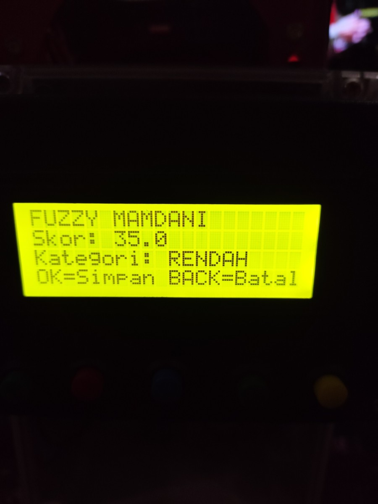

# Elbow Rehab 1-DOF

Final project: a post-stroke elbow exercise device driven by a closed-loop stepper. It measures elbow range of motion before and after training, then scores the session with Fuzzy Mamdani logic. Results appear on an LCD and a live web dashboard.



## Overview

| | |
|---|---|
| **Controller** | ESP32-C6 |
| **Actuator** | NEMA 34 closed-loop stepper, HBS860H driver, 1:3 reduction |
| **Angle sensor** | AS5600 12-bit magnetic sensor |
| **Interface** | LCD 20x4, Python web dashboard |
| **Data** | LittleFS on the device, Excel export from the dashboard |
| **Safety** | Emergency stop, STOP button, NC limit switches |

## System


## Results

| Metric | Value |
|---|---|
| Position tolerance | ±1° |
| Average sensor error | 0.49° |
| Fuzzy score vs MATLAB | 0.025% difference over 14 sessions |

## Session flow

1. **Pre-test:** 3 trials to the maximum comfortable angle.
2. **Training:** 10 motor-assisted repetitions to a fixed target, then a 2-minute rest.
3. **Post-test:** 3 trials, taking the median angle.
4. **Score:** Fuzzy Mamdani gives a 0-100 score, saved to LittleFS.

## Fuzzy Mamdani

The two inputs are the post-test median angle (0-100°) and the change from pre-test to post-test (-20° to 30°). Twelve rules combine them, and centroid defuzzification gives the score.

| Post-test angle | Delta negative | Delta small | Delta medium | Delta large |
|---|---|---|---|---|
| **Low** | Not yet | Low | Medium | Medium |
| **Medium** | Not yet | Low | Medium | Good |
| **High** | Low | Medium | Good | Good |

| Score | Category |
|---|---|
| Below 30 | Not yet |
| 30 to below 50 | Low |
| 50 to below 75 | Medium |
| 75 and above | Good |

## Pin map

| GPIO | Function |
|---|---|
| 18, 19, 20 | STEP, DIR, ENA to HBS860H |
| 1 | BACK button |
| 10 | STOP button |
| 11, 12, 13 | MODE, OK, ZERO buttons |
| 2, 3 | Upper and lower limit switches (NC, active HIGH) |
| 4, 5 | SDA, SCL to AS5600 and LCD |

## Run it

**Firmware:** open `firmware/Rehabilitasi_Siku_WIFI_Dashboard` in Arduino IDE with the ESP32 board package and the LiquidCrystal_I2C library. Set `WIFI_SSID`, `WIFI_PASSWORD` and `DASHBOARD_HOST`, then upload to the ESP32-C6.

**Dashboard:** requires Python 3.11 or newer.

```bash
cd dashboard
pip install -r requirements.txt
python main.py
```

Open http://localhost:8000. The ESP32 connects over USB serial or Wi-Fi TCP on port 9000.

## Repository contents

| Path | Contents |
|---|---|
| `firmware/` | ESP32-C6 Arduino program |
| `dashboard/` | FastAPI backend and web frontend |
| `cad/` | Inventor model of the device and STL for the AS5600 holder |
| `schematic/` | Fritzing wiring file |
| `images/` | LCD photo and block diagram |

## Safety

This is a research prototype, not a certified medical device. The motor can produce high force, so test the emergency stop, limit switches and a dummy load before anyone uses it.

Respondent photos, videos and session data are not included.
